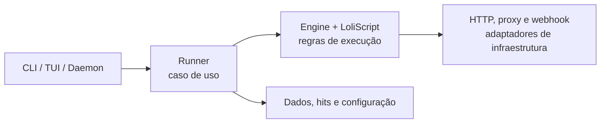

<h1 align="center">⚡ SulphurCK</h1>

<p align="center">
  <strong>Um verificador HTTP leve, assíncrono e nativo para terminal.</strong><br />
  CLI, TUI e daemon em uma única aplicação Rust.
</p>

<p align="center">
  
  
  
  
</p>

> [!WARNING]
> Use apenas em sistemas, contas e endpoints para os quais você tem autorização explícita. O projeto não deve ser usado para acesso não autorizado, credential stuffing ou violação de termos de serviço.

## ✨ O que ele faz

SulphurCK executa fluxos HTTP descritos em `.svb`, processando uma wordlist de forma concorrente e com suporte a proxies. Foi pensado para ambientes modestos e automação legítima de testes de serviços.

| Recurso | Descrição |
| --- | --- |
| 🦀 **Nativo e leve** | Binário Rust; TLS via `rustls`, sem dependência de OpenSSL. |
| 🌐 **HTTP + proxies** | HTTP(S), SOCKS4/SOCKS4a/SOCKS5, cookies e headers. |
| 🧩 **Motor de script** | Subconjunto HTTP do LoliScript: `REQUEST`, `KEYCHECK`, `PARSE`, `FUNCTION`, `UTILITY` e `TCP`. |
| 📊 **Operação no terminal** | CLI para automação, TUI para acompanhamento e base para daemon/IPC. |
| 🔔 **Resultados** | Hits estruturados, saída em arquivo e webhook opcional. |
| 🖥️ **Multiplataforma** | Build nativo e teste contínuo em Windows, Linux e macOS. |

## 🚀 Instalação rápida

### A partir de uma release

Baixe o pacote da sua plataforma na página de Releases, extraia-o e execute:

```bash
# Linux / macOS
./sulphurck --help

# Windows (PowerShell)
.\sulphurck.exe --help
```

### Compilando do código-fonte

Pré-requisito: [Rust stable](https://rustup.rs/) com `cargo`.

```bash
git clone <URL_DO_SEU_REPOSITORIO>
cd SulphurCK
cargo run -- --help
```

Para criar o binário otimizado:

```bash
cargo build --release
```

O executável fica em `target/release/` (`sulphurck.exe` no Windows).

## 🧭 Uso

```bash
# Ver todos os comandos
sulphurck --help

# Executar um fluxo autorizado
sulphurck --config config.svb --wordlist data.txt --bots 4 run --max-cpm 60

# Validar o arquivo antes de executar
sulphurck config validate config.svb

# Inspecionar uma lista de proxies
sulphurck proxy parse proxies.txt

# Utilitários de wordlist
sulphurck wordlist count data.txt
sulphurck wordlist unique data.txt

# Abrir a interface de terminal
sulphurck tui
```

O comando `run` é o padrão quando `--config` é informado. Os valores de `config.svb`, `data.txt`, `hits.txt` e configurações locais são ignorados pelo Git de propósito: podem conter dados sensíveis ou específicos de cada ambiente.

## 🏗️ Arquitetura



O núcleo usa uma **Clean Architecture pragmática**: as interfaces de terminal e rede ficam nas bordas; parser, motor e modelos permanecem independentes delas. Consulte [a arquitetura](/docs/ARCHITECTURE.md) para regras, limites atuais e o plano de evolução.

```text
src/
├── main.rs               # composition root mínimo
├── domain/               # configuração e linguagem de script, sem I/O
├── application/          # engine e runner (casos de uso)
├── infrastructure/       # HTTP, arquivos, proxies, hits, IPC e webhooks
└── presentation/         # adaptadores CLI e TUI
```

## ✅ Qualidade e CI/CD

Todo push e pull request para `main` executa:

1. `cargo fmt --check`
2. `cargo clippy -- -D warnings`
3. Testes unitários
4. Build e smoke test nativos em Ubuntu, Windows e macOS

Todo push concluído em `main` cria a próxima versão automaticamente, gera o commit e a tag, e publica uma GitHub Release com binários por plataforma. O incremento é sequencial por patch: `0.0.1 → 0.0.2 → … → 0.0.9 → 0.1.0`. Veja o workflow em [`.github/workflows/ci.yml`](/.github/workflows/ci.yml).

Para reproduzir localmente:

```bash
cargo fmt --all -- --check
cargo clippy --all-targets --all-features -- -D warnings
cargo test --all-features
cargo build --locked --release
```

## 🤝 Contribuindo

1. Crie uma branch curta e focada.
2. Adicione um teste quando alterar comportamento.
3. Execute o conjunto de qualidade acima antes de abrir o pull request.
4. Mantenha as dependências apontando para dentro, conforme a [arquitetura](/docs/ARCHITECTURE.md).

Issues e PRs devem descrever o comportamento esperado, como reproduzir e o impacto de compatibilidade.

## 📄 Licença

Distribuído sob a [licença MIT](/LICENSE).
