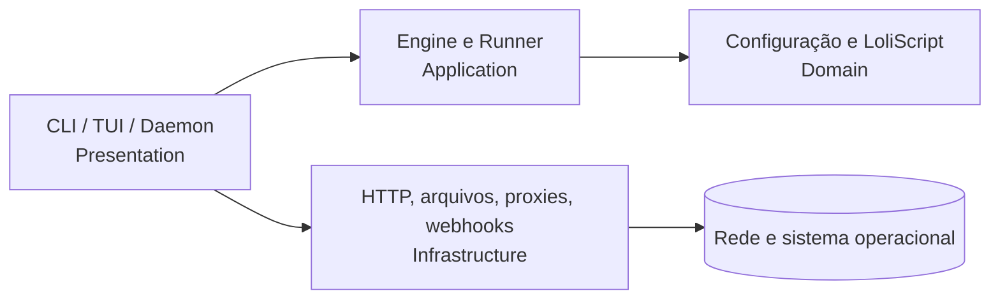

# Arquitetura e evolução

## Implementação adotada

O SulphurCK agora está organizado por fronteiras arquiteturais reais. A regra é a da Clean Architecture: dependências de código apontam para dentro; detalhes de entrega e I/O ficam nas bordas. A camada de domínio não lê arquivos, não abre sockets e não conhece CLI/TUI.

| Área | Módulos atuais | Regra de dependência |
| --- | --- | --- |
| Presentation | `presentation/cli`, `presentation/tui`, `main` | Converte entrada/saída; não implementa regras de negócio. |
| Application | `application/engine`, `application/runner` | Coordena execução, limites, concorrência e regras de status. |
| Domain | `domain/config`, `domain/ls` | Modelos e parser; sem filesystem, rede ou UI. |
| Infrastructure | `infrastructure/*` | Adaptadores de HTTP, filesystem, proxies, hits, IPC e webhooks. |

## Regras de código

- Mantenha `main.rs` como composição fina. Casos de uso novos começam em `application/`, não na CLI.
- Não deixe tipos de `clap`, `ratatui`, `reqwest` ou caminhos específicos de SO atravessarem o domínio.
- Prefira `Result` contextual a `unwrap` e mensagens de erro acionáveis.
- Escreva um teste de regressão para cada correção de parser, regra de status ou transformação de dados.
- Para integrações, esconda I/O atrás de uma fronteira pequena para que o motor seja testável sem rede.

## Próxima expansão obrigatória

Antes de adicionar uma segunda implementação de HTTP, persistência ou mensageria, a aplicação deve declarar uma porta pequena na camada `application/` e a infraestrutura deve implementá-la. Isso evita abstrações antecipadas para o projeto atual, mas preserva a direção correta quando houver uma dependência intercambiável.

O objetivo não é multiplicar diretórios: uma fronteira é criada para reduzir acoplamento, melhorar testes ou trocar uma dependência externa.
